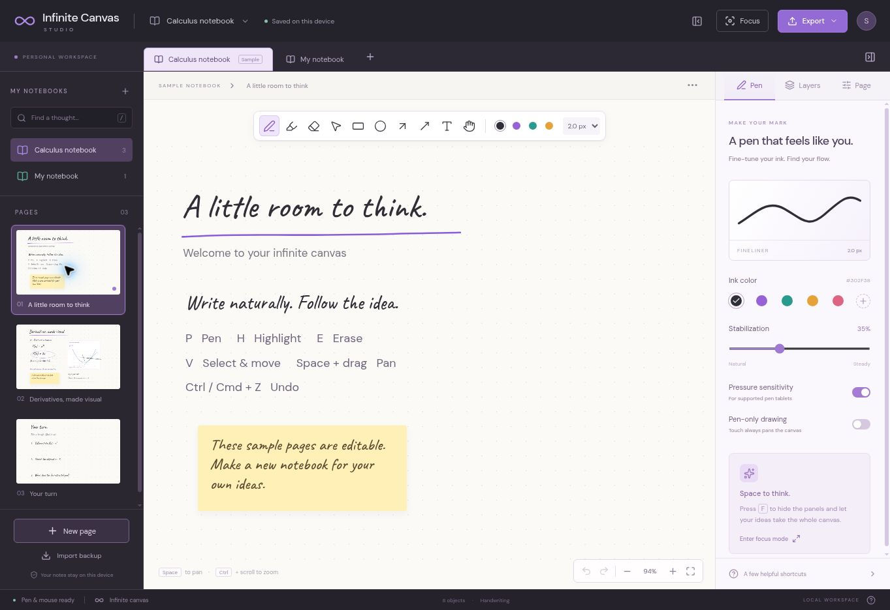

# v0.1 validation record

Checked on 2026-11-05 (UTC). This is the first functional canvas milestone, not certification of the full roadmap or a comparison with iPad handwriting latency.

## Automated checks

Clean installation with `npm ci` succeeded on Linux, Node.js 24.22.1 / npm 11.9.0. `npm run check` passed: strict TypeScript checking, **21 tests across 3 files**, and the production Vite build.

| Area | Evidence |
| --- | --- |
| Document and backup integrity | Sample round trip, duplicate IDs, missing layers, invalid active pages, unsupported versions, nonfinite coordinates, HTTP-compatible ID creation |
| Editing and geometry | Undo/redo boundaries, redo invalidation, cursor-anchored zoom, pressure-preserving movement, stroke hit tests, layer visibility/locking, off-screen and negative content bounds |
| Local persistence | IndexedDB round trip, atomic revision conflicts, additive import, page restoration, last-page preservation |
| Save failures and races | Pending edits during a write, quota errors and retry, retained edits after conflicts, conflict notification during a write, no seeding over unreadable storage |
| PDF assembly | A real PDF is reopened with pdf-lib; all 3 requested pages are present in order, with metadata and page dimensions |
| File naming | Invalid Windows filename characters are sanitized |

The PDF unit test injects a small raster image. It proves document assembly and ordering, not visual fidelity of browser-rendered handwriting.

## Browser smoke checks

The editor was exercised in desktop Chromium. Drawing, undo/redo, notebook/page navigation, and saved-content restoration were checked. The final production bundle opened with the expected notebook, toolbar, inspector and sample content. No application error was observed in that production check; browser-extension metadata errors were excluded.

The notebook PDF action reached **Your export is ready** with a named download link. The browser automation download event timed out after clicking the link, so receipt of the downloaded PDF is **not verified**. PNG and JSON download/import should also be exercised in a normal local browser and on the deployed URL before treating export as release-qualified.

A React DOM error occurred during an earlier development hot-reload session. It did not recur in the clean production-preview check. Further device/browser testing is still appropriate.

## Checks still required

- Run the configured GitHub Actions matrix on Ubuntu and Windows.
- Connect Vercel, deploy this branch, and check actual hosted build, deep-link refresh, persistence, and all downloads/imports.
- Test physical pen-tablet pressure, palm/touch behavior, long strokes, high refresh-rate displays, Safari and mobile layouts.
- Measure latency and stress-test large notebooks; no numerical latency or superiority claim is made.
- Inspect multi-page PDF output visually after downloading it, including hidden layers and content beyond the viewport.

## Product scope

Handwriting recognition, LaTeX conversion, arbitrary-expression graphs, 3D, PDF/image import, cloud sync, authentication and collaboration remain future milestones. Local notes are stored per browser origin. The loaded editor has no backend dependency, but offline reopening is not yet implemented.
